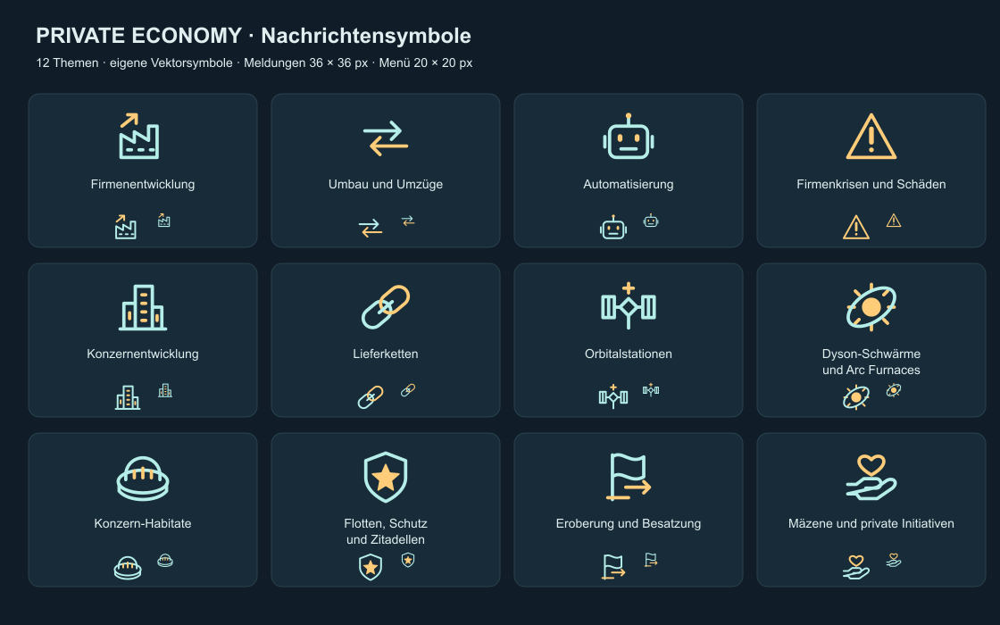

# Private Economy 0.36.6 – Nachrichtenmenü und Symbole

Stand: 26.10.2026 (Europe/Berlin). Kein Spieltest durch Codex; die folgenden
Spielprüfungen sind für den Nutzer vorgesehen und noch offen.

## Aufruf und Bedienung

### Nachprüfung für Korrektur 0.36.7 (26.10.2026)

Der Nutzer meldete in 0.36.6: X schaltet „Firm development“ um und öffnet das
Fenster erneut. Auf beiden Menüseiten ist jetzt die wirkungslose Schließen-Option
mit `default_hide_option = yes` ausdrücklich als Schließaktion markiert.

Nach Neustart mit 0.36.7 bitte auf jeder Seite prüfen: Zustand der Kategorien
merken, X anklicken, Menü erneut über die Hauptstadt öffnen. X muss das Fenster
schließen; sämtliche Einstellungen müssen gleich bleiben. Auch mit der ersten
Kategorie auf „Stumm“ wiederholen. Reguläre Umschalter und der sichtbare
Schließen-Button müssen weiter funktionieren. Keine Spielprüfung durch Codex;
die neue Zuordnung ist durch einen statischen Regressionstest abgesichert.

Auf der eigenen Hauptstadt: **Entscheidungen → Privatwirtschaft: Nachrichten
einstellen**. Kostenlos, ohne Bauzeit oder Abklingzeit. Auf anderen Kolonien
soll die Entscheidung nicht erscheinen; KI-Reiche bekommen das Menü nicht.

Die zwei Seiten enthalten jeweils sechs Kategorien. Der angezeigte Zustand
**Aktiv/Stumm** ist der aktuelle Zustand, ein Klick kehrt ihn um und öffnet
dieselbe Seite erneut. „Alle Meldungen aktivieren“ stellt den Standard wieder
her; „Alle Meldungen stummschalten“ betrifft beide Seiten.

| Kategorie | Symbol | Erfasste Meldungen |
| --- | --- | --- |
| Firmenentwicklung | Fabrik mit Wachstumspfeil | Gründung, Distriktkauf, Wachstum, Schrumpfung, Verstaatlichung |
| Umbau und Umzüge | Gegenläufige Pfeile | Produktionswechsel, Umzug, Umzug wegen Versorgung |
| Automatisierung | Roboter | Automatisierung und Rückbau, auch durch Konzerne |
| Firmenkrisen und Schäden | Warndreieck | Insolvenz, Zerstörung, Baustellenabbruch, Liquiditätskrise |
| Konzernentwicklung | Firmenzentrale | Gründung, Beitritt, Übernahme, Auflösung, Wiederaufbau |
| Lieferketten | Kettenglieder | Beginn und Ende von Lieferverträgen zwischen Firmen |
| Orbitalstationen | Station mit Solarpaneelen | Bau und Kauf von Konzernstationen |
| Dyson-Schwärme und Arc Furnaces | Stern mit Umlaufbahn | Baubeginn, Fertigstellung, Ausbau |
| Konzern-Habitate | Habitatkuppel | Bau, Besiedlung, Hauptsitz, Erstattungen, Ende der Rechte |
| Flotten, Schutz und Zitadellen | Schild mit Stern | Flotten-/Schutzaufträge, Jagd, Konvoischutz, Werkschutz, Zitadellen, Ende des Rüstungsvertrags |
| Eroberung und Besatzung | Flagge mit Wechselpfeil | Konzern-/Hauptsitzwechsel und Kontributionen |
| Mäzene und private Initiativen | Hand mit Herz | Prototyp-Ergebnis, Touristenunglück, aufgedeckte Spionage, Ende privater Lieferzusagen |

## Manuelle Prüfschritte

1. Stellaris mit der aktualisierten Mod neu laden, damit neue Ereignisse,
   Nachrichtentypen und Texturen registriert werden. Bestehenden Spielstand
   laden; alle Kategorien müssen zunächst aktiv sein.
2. Auf Hauptstadt öffnen; auf normaler Kolonie Abwesenheit kontrollieren.
   Beide Seiten, Einzelumschaltung, globale Schalter und Schließen prüfen.
   Lange Optionsnamen müssen lesbar sein; gegebenenfalls im Fenster scrollen.
3. Firmenentwicklung stummschalten, Lieferketten aktiv lassen. Bei den nächsten
   entsprechenden Vorgängen dürfen Firmenmeldungen fehlen, Liefermeldungen
   müssen weiterhin erscheinen. Unternehmen müssen trotzdem gegründet werden,
   wachsen und ihre Kosten zahlen. Bereits sichtbare Meldungen bleiben stehen.
4. Nach Reaktivierung erscheinen nur neue Meldungen; es gibt kein Nachholen
   unterdrückter Meldungen. Ein Symbol pro Kategorie in Nachrichtenleiste,
   Toasts und Menü kontrollieren. Auch reine Infofenster tragen ihr Thema im Titel.
5. „Alle stumm“: Fusionsentscheidungen, Mäzenangebote, Habitatgenehmigungen,
   Flottenverträge und andere echte Auswahlereignisse müssen weiterhin erscheinen.
   Manuell geöffnete Firmenregister bleiben ebenfalls verfügbar.
6. Prototyp-Ergebnis und Touristenunglück mit aktiver sowie stummer Kategorie
   vergleichen: Forschung, Ruf und Unfallmodifikatoren müssen jeweils genau
   einmal gelten. Stummes Touristenunglück wirkt sofort bei Fälligkeit; sichtbar
   wie bisher bei Bestätigung. Die ursprünglichen IDs `pe.206` und `pe.228`
   bleiben für bereits geplante Ereignisse erhalten.
7. Speichern, neu laden: Auswahl bleibt bestehen. Hauptstadtwechsel:
   Entscheidung wandert mit der Hauptstadt, Auswahl bleibt beim Reich.
   Bei Mehrspielerbetrieb gelten die Filter jeweils für das empfangende Reich;
   diese Scope-Eigenschaft ist statisch geprüft, Multiplayer ist nicht getestet.
8. Allgemeine Stellaris-Nachrichteneinstellungen: zwölf neue benannte Themen
   prüfen. Dort unterdrückte Meldungen werden durch „Aktiv“ im Mod nicht erzwungen.
   Einstellungen für den alten gemeinsamen Nachrichtentyp werden nicht automatisch
   auf die zwölf neuen Typen übertragen. Der alte Typ bleibt für bereits gespeicherte
   Meldungen definiert.

## Statische Prüfungen

- `node tools/validate.mjs`: allgemeine Modprüfung inklusive Generatorvergleich
  und der folgenden speziellen Prüfungen. Schreibt generierte Dateien neu.
- `node tools/test-message-settings.mjs`: rein lesende Prüfung der Meldungsfilter,
  Kategorien, Umschalter, Hauptstadtentscheidung, Infofenster, Symbolzuordnung
  und DDS-Dateien. Prüft auch, dass Meldungsfilter keine benachbarten
  Wirtschaftseffekte einschließen und Auswahlereignisse nicht sperren.
- Die Symbolübersicht wurde außerhalb des Spiels visuell geprüft. Sie zeigt
  außerdem die tatsächlich exportierten DDS-Pixel in 36 und 20 Pixel Größe.
- Keine Aussage über bestandenen Engine-Load, UI-Darstellung, Save/Load oder
  tatsächliche Ereignisausführung im Spiel.

## Pflege der Symbole

Originale Vektorgeometrien: `tools/generate-message-icons.mjs`; generierte
SVG-Quellen: `gfx/interface/icons/message/source/`. Keine kopierten Spielsymbole.
Export: `node tools/generate-message-icons.mjs [Pfad/zu/node_modules]`, benötigt
das Paket `sharp`. Die DDS-Dateien sind unkomprimierte BGRA-Texturen mit Alpha
im selben Headerformat und derselben 36-Pixel-Meldungsgröße wie das untersuchte
Vanilla-Symbol. Inline-Symbole sind 20 × 20 Pixel groß.

Meldungstypen, Sprite-Zuordnungen, Menü und Texte entstehen über
`tools/generate-firms.mjs` aus `tools/message-settings.mjs`. Den allgemeinen
Generator auszuführen exportiert die Symbolbilder nicht erneut.
